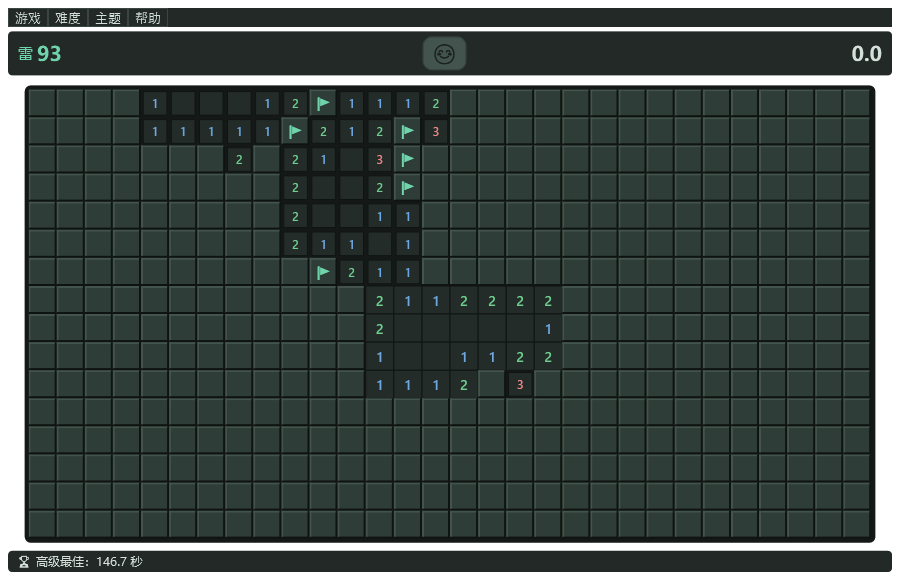
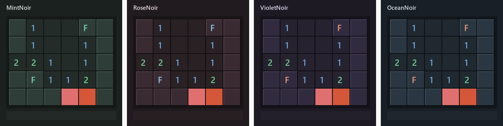

# 无猜扫雷

[](LICENSE)
[](https://dotnet.microsoft.com/)
[](#环境要求)

一款 Windows 平台的扫雷，核心卖点是**每一局都经过求解器验证，保证可以纯逻辑推理通关，不需要盲猜**。

开局第一次点击之后，程序会在后台反复生成盘面，直到求解器确认「只靠逻辑就能推到通关」才交付给你。生成不出来时会如实告诉你，而不是假装它是无猜盘。



## 功能

- **无猜保证** —— 每局都由求解器验证，不需要猜测；这是它和经典扫雷最大的区别
- **逻辑提示（H）** —— 用求解器算出当前局面里**必然安全**或**必然是雷**的格子并高亮标出，而不是随机开一格
- **快速排雷** —— 左右键同时按（和弦），对已翻开的数字格一次掀开周围；旗不够时会让周围未标记的格子闪一下提醒
- **纯键盘操作** —— 方向键移动光标，空格掀开，F 插旗
- **四套暗色主题** —— 午夜薄荷 / 午夜樱粉 / 午夜紫罗兰 / 午夜海蓝
- **排行榜与统计** —— 每个难度的最快前 10 名、总局数、胜负、胜率、连胜
- **自适应棋盘** —— 窗口缩放时格子跟着放大，最长边可以有 80px

## 四套主题



## 下载与运行

### 直接下载

从 [Releases](../../releases) 下载 `Minesweeper.exe` 直接运行（需要 [.NET 9 桌面运行时](https://dotnet.microsoft.com/download/dotnet/9.0)）。

主题资源已编译进程序集，**没有额外的资源文件夹**，单独拷一个 exe 就能跑。

### 自己构建

```bash
# 需要 .NET 9 SDK
dotnet build Minesweeper.sln -c Release

# 跑测试（80 个用例）
dotnet test Minesweeper.sln -c Release

# 发布
dotnet publish src/Minesweeper/Minesweeper.csproj -c Release -o publish
```

### 环境要求

- Windows 10 2004 或更高（用到 `DwmSetWindowAttribute` 切换深色标题栏，老系统上会静默跳过）
- .NET 9 桌面运行时

## 操作

| 操作 | 说明 |
|------|------|
| 左键 | 掀开格子 |
| 右键 | 插旗 / 取消旗 |
| 左右键同时按 | 对已翻开的数字格快速排雷（和弦） |
| 方向键 + 空格 / 回车 | 纯键盘操作 |
| F | 给光标所在格插旗 / 取消旗 |
| H | 提示一个必然安全或必然是雷的格子 |
| F2 / Ctrl+N | 新游戏 |

## 技术要点

- **求解器**（`Services/SolverService.cs`）
  推理分两层：基础计数（某数字格周围剩余未知格「全安全」或「全是雷」），
  以及**约束图连通分量分解 + 分量内完整枚举**。按分量拆开之后，规模上限只作用于单个分量，
  某个分量太复杂也不会拖累其他分量。求解全程在数组化的内部模拟盘上跑，不触碰真实棋盘状态。

- **棋盘自绘**（`Controls/BoardCanvas.cs`）
  480 个格子全部由一个 `Canvas` 自绘。Pen 静态缓存并 `Freeze()`、`FormattedText` 按
  「文本 + 量化字号 + 颜色 + DPI」缓存、动画定时器只在真的有动画时运行、集合变化通知合并成一次重绘。
  软件渲染（`RenderCapability.Tier == 0`）下自动关闭动画，优先保证点击跟手。

- **首击安全** —— 第一次点击之后才布雷，并保证首击九宫格内没有雷。

## 项目结构

```
src/Minesweeper/          主程序（WPF）
  Controls/BoardCanvas.cs   棋盘自绘控件：绘制、动画、鼠标/键盘交互
  ViewModels/               主视图模型与格子视图模型
  Models/                   棋盘、格子、难度、统计数据
  Services/                 求解器、成绩持久化、主题
  Themes/                   四套配色的资源字典
tests/Minesweeper.Tests/  单元测试（80 个用例）
docs/技术设计文档.md       完整的设计说明与修订记录
tools/                    图标与主题样张的生成脚本（Python）
```

## 文档

- [技术设计文档](docs/技术设计文档.md) —— 架构、求解器原理、渲染优化、逐版本的修订记录
- [CHANGELOG](CHANGELOG.md) —— 各版本的改动摘要

## 协议

[MIT](LICENSE)
